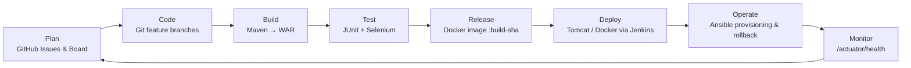
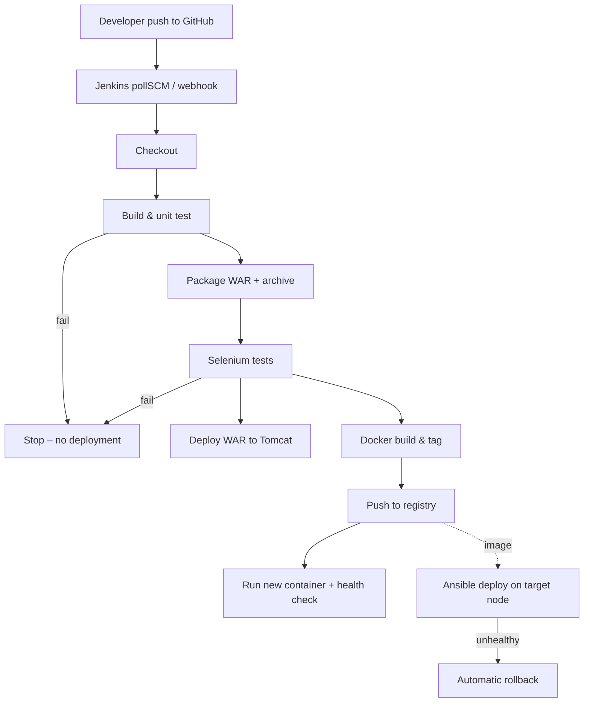

# Experiment 2 — Agile Planning and DevOps Workflow

## 2.1 User stories and acceptance criteria

**US-1 File an appeal** (T05)
*As a citizen, I want to file an appeal against my parking ticket online, so that I don't have to visit the traffic office.*
- Given a valid ticket number, matching vehicle number, my details, a reason of 30–1000 characters and a PDF/JPG/PNG under 2 MB, when I submit, then I see a reference like `APL-20261015-K3F9` and status **Submitted**.
- Given the same ticket already has an open appeal, when I submit again, then I am told an appeal is already being processed.

**US-2 Automatic validation** (T06)
*As a reviewer, I want obviously invalid appeals blocked at submission, so that my queue only contains genuine cases.*
- Ticket must exist and match the format `PV-123456`.
- Vehicle number must match the one on the ticket (spaces/hyphens/case ignored).
- Appeal must be within 30 days of the violation date.
- Email and 10-digit mobile number must be valid.
- Evidence file must be PDF/JPG/PNG, ≤ 2 MB, and its content must really be that type.
- Each error is shown next to the field that caused it.

**US-3 Reviewer queue** (T07)
*As a reviewer, I want to sign in and see all appeals with counts by status, so that I can prioritise my work.*
- Reviewer pages are not reachable without the access key.
- Dashboard shows counts for Submitted / Under review / Approved / Rejected and filters by status.
- Opening a Submitted appeal moves it to **Under review**.

**US-4 Decide** (T08)
*As a reviewer, I want to approve or reject an appeal with remarks, so that the citizen gets a clear, accountable outcome.*
- Approve works with or without remarks.
- Reject is refused unless remarks of at least 10 characters are entered.
- A decided appeal cannot be decided again.

**US-5 Track** (T09)
*As a citizen, I want to check my appeal with my reference and email, so that I know where it stands.*
- Correct reference + email shows status timeline, ticket details and reviewer remarks.
- A wrong email shows "No appeal matches" (no data leaked).

**US-6 Automated delivery** (T10–T15)
*As the project team, I want every commit built, tested and deployed automatically, so that releases are repeatable and safe.*
- A commit triggers Jenkins; unit and Selenium tests run; failures stop deployment.
- A versioned Docker image is pushed and deployed; Ansible can rebuild a server and roll back.

## 2.2 Product backlog (prioritised)

| Rank | ID | Item | Story | Points | Priority |
|---|---|---|---|---|---|
| 1 | T01 | Problem definition & scope | — | 2 | Must |
| 2 | T02 | Backlog, DoD, DevOps workflow | — | 2 | Must |
| 3 | T03 | SRS, architecture, local setup | — | 3 | Must |
| 4 | T04 | Repo skeleton & branch policy | — | 2 | Must |
| 5 | T05 | Appeal submission + ticket lookup | US-1 | 5 | Must |
| 6 | T06 | Validation rules | US-2 | 5 | Must |
| 7 | T07 | Reviewer login & queue | US-3 | 3 | Must |
| 8 | T08 | Approve / reject | US-4 | 3 | Must |
| 9 | T09 | Tracking page + REST API | US-5 | 3 | Must |
| 10 | T10 | Jenkins CI job | US-6 | 3 | Must |
| 11 | T11 | Jenkinsfile + Tomcat deploy | US-6 | 5 | Must |
| 12 | T12 | Selenium suite + test gate | US-6 | 5 | Must |
| 13 | T13 | Dockerfile & lifecycle | US-6 | 3 | Must |
| 14 | T14 | Jenkins → Docker CD | US-6 | 5 | Must |
| 15 | T15 | Ansible provision + rollback | US-6 | 5 | Must |

## 2.3 Sprint plan (4 × 1 week)

| Sprint | Goal | Tasks | Points |
|---|---|---|---|
| 1 | Agreed scope, design and repository | T01–T04 | 9 |
| 2 | Working MVP (citizen + reviewer flows) | T05–T09 | 19 |
| 3 | Continuous integration and testing | T10–T12 | 13 |
| 4 | Containerised continuous deployment and operations | T13–T15 | 13 |

Each sprint: planning (Monday), daily 10-minute stand-up, review + retrospective (Friday). Roles — Product Owner, Scrum Master, Developer(s), QA, DevOps — are assigned to team members in the team's task board.

## 2.4 Kanban task board

Create a GitHub Project (Board view) with columns **Backlog → To do → In progress → In review → Done** and add one issue per task (T01–T15) using the *User story / task* template. Move cards as work progresses; the screenshot of this board is the "task board" deliverable. Starting state at the end of Sprint 1 planning:

| Backlog | To do | In progress | In review | Done |
|---|---|---|---|---|
| T05–T15 | T03, T04 | T02 | — | T01 |

## 2.5 Definition of Done

A task is **Done** only when all of these are true:
1. Code is on a correctly named branch and merged into `develop` through a reviewed pull request.
2. It builds with `mvn clean package` with no errors.
3. Unit tests pass (`mvn test`); new logic has at least one test.
4. If the UI changed, the Selenium journey covering it passes (`mvn verify -Pselenium`).
5. The Jenkins pipeline for the merge commit is green.
6. The acceptance criteria in the issue are ticked, and the card is in **Done**.
7. README / docs updated if behaviour or setup changed.

## 2.6 DevOps lifecycle

