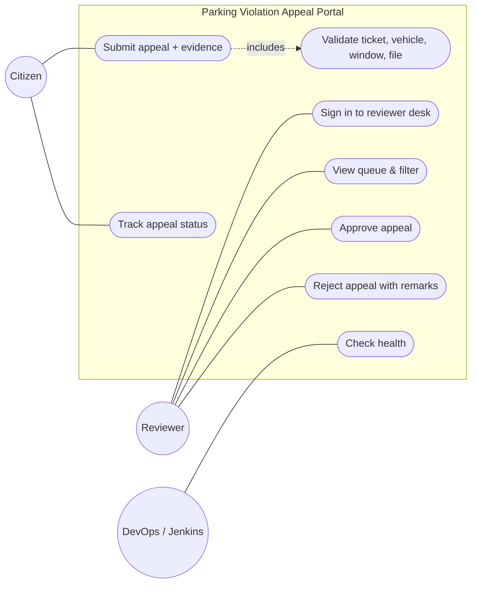
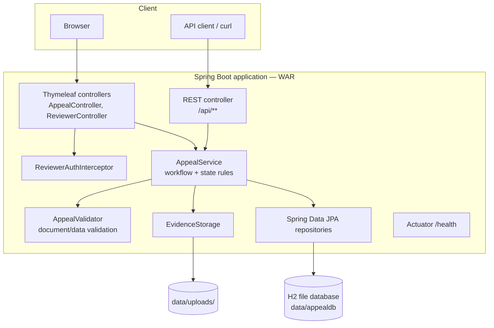
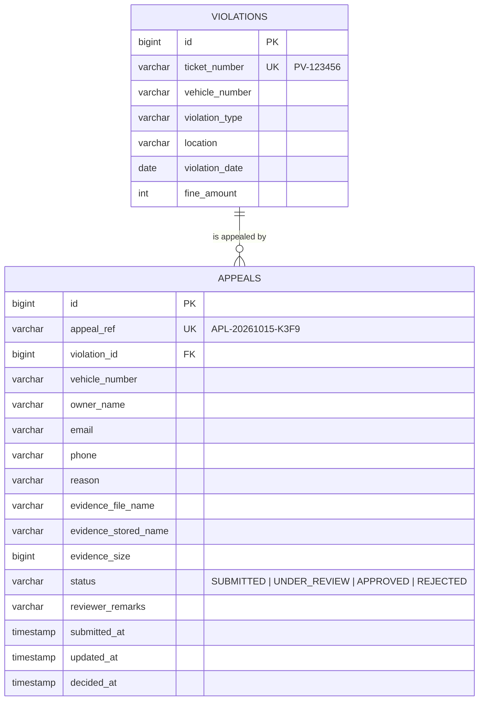

# Experiment 3 — Requirements, Architecture and Technology Setup

## 3.1 SRS summary

**Purpose.** A web portal for filing and deciding appeals against parking violations, delivered through an automated DevOps pipeline.

**Functional requirements**

| ID | Requirement |
|---|---|
| FR-1 | The citizen can submit an appeal with ticket number, vehicle number, name, email, mobile, reason and one evidence file. |
| FR-2 | The system validates format of every field, that the ticket exists, that the vehicle matches, the 30-day window, that no other appeal is open for the ticket, and the evidence type/size/content. |
| FR-3 | On success the system creates a unique reference `APL-yyyyMMdd-XXXX` with status SUBMITTED. |
| FR-4 | Reviewers sign in with an access key and see a queue with status counts and filters. |
| FR-5 | Opening a SUBMITTED appeal sets it to UNDER_REVIEW. |
| FR-6 | A reviewer can APPROVE (optional remarks) or REJECT (remarks ≥ 10 chars). Final decisions are locked. |
| FR-7 | The citizen can track status with reference + email. |
| FR-8 | A REST API exposes submit, track, list and decide. |
| FR-9 | `/actuator/health` reports UP/DOWN with environment, version and build. |

**Non-functional requirements**

| ID | Requirement |
|---|---|
| NFR-1 | Pages respond in < 2 s on a laptop. |
| NFR-2 | Works on desktop and mobile browsers. |
| NFR-3 | Evidence files are type-checked by content (magic bytes), not only by extension. |
| NFR-4 | Configuration (environment, reviewer key, data folder) comes from environment variables, never hard-coded per server. |
| NFR-5 | Every build is reproducible from Git; every deployment is automated and reversible. |
| NFR-6 | Container runs as a non-root user and exposes a health check. |

## 3.2 Use-case diagram

## 3.3 Architecture

**Deployment targets.** The same `parking-appeal.war` runs (a) inside Tomcat 10.1 at `/parking-appeal`, and (b) inside a Docker container with `java -jar` on port 8080. H2 keeps the MVP self-contained (no DB server to install); the JPA layer allows switching to MySQL/PostgreSQL by changing `spring.datasource.*` only.

## 3.4 Technology stack

| Layer | Choice | Why |
|---|---|---|
| Language | Java 17 | LTS; required by Spring Boot 3 |
| Framework | Spring Boot 3.3 (Web, Thymeleaf, Data JPA, Actuator) | Fast MVP, embedded + WAR deploy |
| Build tool | **Maven** | Lab requirement; Jenkins/Selenium integration |
| Database | H2 (file mode) | Zero install; persists in `data/` |
| App server | **Tomcat 10.1** (Jakarta EE 10) | Lab requirement (Exp 8) |
| Container | Docker, multi-stage build | Exp 11–12 |
| CI/CD | Jenkins (declarative Jenkinsfile) | Exp 7–12 |
| UI tests | Selenium WebDriver 4 + JUnit 5 + Failsafe | Exp 9–10 |
| Config management | Ansible + community.docker | Exp 13–14 |
| VCS | Git + GitHub | Exp 4–6 |

## 3.5 Data model

**Status machine:** `SUBMITTED → UNDER_REVIEW → APPROVED | REJECTED` (decision allowed from SUBMITTED or UNDER_REVIEW; APPROVED/REJECTED are final).

## 3.6 Page and API list

| Method | Path | Who | Purpose |
|---|---|---|---|
| GET | `/` | all | Home |
| GET | `/appeals/new` | citizen | Appeal form |
| POST | `/appeals` | citizen | Submit (multipart) |
| GET | `/appeals/confirmation` | citizen | Reference after submit |
| GET | `/track?ref=&email=` | citizen | Track status |
| GET/POST | `/reviewer/login` | reviewer | Sign in with access key |
| GET | `/reviewer?status=` | reviewer | Queue + counts |
| GET | `/reviewer/appeals/{ref}` | reviewer | Detail (marks Under review) |
| POST | `/reviewer/appeals/{ref}/decision` | reviewer | `decision=APPROVE|REJECT`, `remarks` |
| GET | `/reviewer/appeals/{ref}/evidence` | reviewer | View evidence file |
| GET | `/api/violations/{ticket}` | public | Ticket lookup (JSON) |
| POST | `/api/appeals` | public | Submit (multipart) → 201 / 400 `{errors}` |
| GET | `/api/appeals/{ref}?email=` | citizen | Status JSON |
| GET | `/api/appeals?status=` | reviewer (`X-Reviewer-Key`) | List |
| POST | `/api/appeals/{ref}/decision` | reviewer (`X-Reviewer-Key`) | `{"decision":"APPROVE","remarks":"..."}` |
| POST | `/api/test/violations` | tests only (`APP_TEST_SUPPORT=true`) | Creates a fresh ticket for Selenium |
| GET | `/actuator/health`, `/actuator/info` | ops | Monitoring |

## 3.7 Configuration settings

| Property | Env variable | Default | Meaning |
|---|---|---|---|
| `app.env` | `APP_ENV` | dev | Environment name (footer, health) |
| `app.reviewer-key` | `REVIEWER_KEY` | reviewer123 | Reviewer access key |
| `app.data-dir` | `APP_DATA_DIR` | ./data | H2 DB + uploads folder |
| `app.simulate-failure` | `APP_SIMULATE_FAILURE` | false | Forces health DOWN (rollback drill) |
| `app.test-support` | `APP_TEST_SUPPORT` | false | Enables `/api/test/violations` |
| `server.port` | `PORT` | 8080 | HTTP port |

## 3.8 Local setup

See **RUN_GUIDE.md → Part A** (install JDK 17 + Maven, `mvn spring-boot:run`, open http://localhost:8080).
